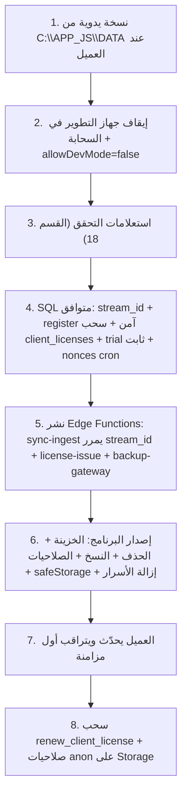

# خطة الإصلاح الموثّقة: كل مشكلة، حلها، وتأثيرها على العميل الحالي

> [!IMPORTANT]
> **راجعت كل مشكلة من جديد على الكود سطر بسطر**، وشغّلت استعلامات **قراءة فقط** على نسخة قاعدة البيانات الموجودة في المستودع (`APP_JS/DATA`).
> كل بند عليه **درجة تأكيد** من دول:
> - 🟢 **مؤكد من الكود**
> - 🔵 **مؤكد من البيانات المحلية**
> - 🟠 **محتاج تأكيد من السيرفر** (مقدرش أوصله)

---

## 0. حقائق اتأكدت منها قبل أي حل

### 0.1 ملف العميل الحالي (من نسخة `APP_JS/DATA/accounting.db`) 🔵
| البند | القيمة |
|---|---|
| `company_id` | `715526d2-f05a-458f-8cf7-179ee172a7a1` (الشركة الأصلية LEGACY) |
| `license_status` / `invite_expiry` | `lifetime` / `2099-12-31` |
| المستخدمين | مستخدم واحد `Jimmy` (Admin). **مفيش حساب `admin`** |
| البيانات | 80 طرف، 147 سطر دفتر، 200 حركة خزينة (74 منها مربوطة بطرف)، **0 فاتورة بيع** |
| أنواع الحركات في الدفتر | `opening_balance, purchase_invoice, treasury_expense, treasury_income` |
| سلامة الدفتر الحالية | **0** سند على طرف غلط، **0** سطر ناقص، **0** سطر يتيم، **0** فرق بين `parties.balance` ومجموع الدفتر |

> [!WARNING]
> افترضت إن النسخة المحلية دي **صورة من بيانات العميل الحقيقي**. لازم تتأكد بنفسك إن `company_id` على جهاز العميل هو `715526d2-...` (الاستعلام موجود في القسم 4).

### 0.2 التحديث نفسه هل بيلمس البيانات؟ 🟢
- ملف التثبيت [installer.nsh](file:///d:/JImmy%20Golden/frontend-desktop/build/installer.nsh) **ما بيمسحش `C:\APP_JS\DATA`**. هو بيعمل الفولدرات لو مش موجودة وبس.
- أي تغيير في هيكل SQLite بيتطبق تلقائياً مع كل تشغيل من [db.js](file:///d:/JImmy%20Golden/frontend-desktop/src/main/db.js).
- ⚠️ **فيه نقطة لازم تاخد بالك منها:** الـ Triggers معمولة بـ `CREATE TRIGGER IF NOT EXISTS`، و**أي تعديل عليها مش هيوصل لقاعدة العميل إلا لو حطيت `DROP TRIGGER IF EXISTS` قبلها**.
- ⚠️ الـ installer بيعمل `taskkill /f` للبرنامج. لو التحديث بدأ من جوه البرنامج، `prepareForUpdateShutdown` بيقفل القاعدة بأمان الأول. لكن نسخة الإغلاق الاحتياطية **مش بتتعمل** في الحالة دي.

### 0.3 تصحيحات على التقرير اللي فات (من غير مجاملة)
| البند | التصحيح |
|---|---|
| C3 (مسح `license_status`) | **بيشتغل بس لو النت مقطوع أو الدومين محجوب.** لو البرنامج متصل، السحابة بتفرض حالتها هي. كمان محتاج فاتورة بيع واحدة على الأقل |
| `admin/admin` | بيتعمل **في القواعد الجديدة بس**، وفيه إجبار على تغيير كلمة المرور عند الدخول ([auth.js renderer:L135](file:///d:/JImmy%20Golden/frontend-desktop/src/renderer/views/auth/auth.js#L135)). **مش موجود عند العميل.** نزّلته لمتوسط |
| تحويل أنواع الحركات لـ `opening_balance` | كل الأنواع اللي عند العميل ليها تحويل صحيح. **مفيش تأثير حالياً** |
| فرق `remaining_amount` في 3 فواتير شراء | **مش خطأ.** دي ميزة `custom_remaining_amount` مقصودة ([purchases.js:L226-227](file:///d:/JImmy%20Golden/frontend-desktop/src/main/handlers/purchases.js#L226-L227)). بس معناها إن **أي إعادة بناء كاملة للدفتر هتغيّر أرصدة الموردين بصافي 14,350** (الفواتير 41 و42 و44). علشان كده **ممنوع** أي إصلاح يعيد بناء الدفتر كله |
| H1 (سندات الخزينة) | **أخطر من اللي قلته قبل كده.** التفاصيل في البند 9 |
| **جديد C10** | **جهاز التطوير بيبعت بيانات لشركة العميل الحقيقي في السحابة.** التفاصيل في البند 1 |

---

## 1. 🔴 C10 (جديد): جهاز التطوير بيكتب في شركة العميل الحقيقي في السحابة

**التأكيد:** 🟢 + 🔵
- [main.js:L635](file:///d:/JImmy%20Golden/frontend-desktop/src/main/main.js#L635) بيمرر `allowDevMode: !app.isPackaged`، فالمزامنة **شغالة في وضع التطوير** وبتروح على سيرفر الإنتاج نفسه ([L639](file:///d:/JImmy%20Golden/frontend-desktop/src/main/main.js#L639)).
- قاعدة التطوير `company_id` بتاعها هو **نفس** معرّف العميل (LEGACY)، ومعرّف الجهاز `230d05a7-7e1a-47d0-ae40-d58690966102`، ده غير جهاز العميل المسجّل `697b46e5-...` في [03_device_registration.sql:L15](file:///d:/JImmy%20Golden/supabase/production-deployment/03_production_device_registration.sql#L15).
- ملف `sync_state.db` المحلي بيوضح إن **4 دفعات اتبعتت بنجاح يوم 2026-10-13**، والدفعة رقم 1 كان فيها 222 حدث (كل الأطراف وكل الدفتر).

**الخطر:** فيه جهازين بيكتبوا على شركة واحدة، وكل واحد بتسلسل أرقام منفصل. لو السيرفر طبّق دفعات التطوير، يبقى بيانات التطوير **فوق** بيانات العميل في السحابة، و**عدّاد التسلسل في السيرفر اتقدّم**. ساعتها دفعات العميل الحقيقي اللي رقمها أصغر **بتتجاهل من غير ما حد يعرف** (المشكلة C9).

**الحل:**
1. فوراً على السيرفر:
```sql
UPDATE public.mobile_devices SET is_active = false WHERE id = '230d05a7-7e1a-47d0-ae40-d58690966102';
```
2. في الكود ([main.js:L633-643](file:///d:/JImmy%20Golden/frontend-desktop/src/main/main.js#L633-L643)): `allowDevMode: false`. ولو محتاج تجرب المزامنة، استخدم مشروع Supabase منفصل للتجارب بمتغير بيئة.
3. غيّر `company_id` في قاعدة التطوير لـ UUID خاص بالتطوير.

**التأثير على العميل:** ✅ **حمايه ليه.** ومحتاج إجراء: شغّل استعلامات القسم 4 (أ) لو `last_applied_seq_no` أكبر من تسلسل العميل، أو (ب) لو جهاز `230d05a7` كان شغال. ولو ده حصل، يبقى بيانات العميل في السحابة **محتاجة تتعمل لها مزامنة كاملة من جديد** بعد إصلاح C9.

---

## 2. 🔴 C9: دفعات بتضيع في السحابة من غير تنبيه

**التأكيد:** 🟢
- [01_schema.sql:L348-356](file:///d:/JImmy%20Golden/supabase/production-deployment/01_production_schema_and_security.sql#L348-L356): لو `p_batch_seq_no <= last_applied`، السيرفر بيرجّع `success: true` و`batch_seq_no` من غير ما ينفّذ حاجة.
- [syncEngine.js:L718-735](file:///d:/JImmy%20Golden/frontend-desktop/src/main/sync/syncEngine.js#L718-L735): العميل بيقارن `batch_seq_no` بس، فبيعتبرها نجاح ويحدّث جدول الظل، والتغييرات مش بتتبعت تاني. وكلمة `already_applied` **مش مستخدمة في أي مكان** في كود البرنامج.
- **امتى بيحصل:** لما تتمسح `sync_state.db`، أو تعيد التثبيت على جهاز جديد بنفس `accounting.db`، أو تستعيد فولدر `DATA` قديم، أو يكون فيه جهازين على نفس الشركة (زي C10).

**الحل (`stream_id` يحدد كل تيار مزامنة):**

SQL (متوافق مع النسخ القديمة):
```sql
ALTER TABLE public.mobile_sync_meta ADD COLUMN IF NOT EXISTS stream_id UUID;
```
وجوه `private.apply_delta_sync_batch` تضيف `p_stream_id UUID DEFAULT NULL`، وبعد القفل مباشرة:
```sql
SELECT last_applied_seq_no, stream_id INTO v_last_applied_seq, v_stream
FROM public.mobile_sync_meta WHERE company_id = p_company_id FOR UPDATE;

IF p_stream_id IS NOT NULL THEN
    IF v_stream IS NULL THEN
        UPDATE public.mobile_sync_meta SET stream_id = p_stream_id WHERE company_id = p_company_id;
        IF p_batch_seq_no <= v_last_applied_seq THEN
            RETURN jsonb_build_object('success', false, 'status', 'resync_required', 'expected_seq', v_last_applied_seq + 1);
        END IF;
    ELSIF v_stream <> p_stream_id THEN
        RETURN jsonb_build_object('success', false, 'status', 'stream_conflict');
    END IF;
ELSIF v_stream IS NOT NULL THEN
    RETURN jsonb_build_object('success', false, 'status', 'stream_conflict');
END IF;
```
Edge Function ([index.ts:L360-367](file:///d:/JImmy%20Golden/supabase/functions/sync-ingest/index.ts#L360-L367)): تمرر `payload.stream_id ?? null`.

الكود عند العميل ([syncEngine.js](file:///d:/JImmy%20Golden/frontend-desktop/src/main/sync/syncEngine.js)):
- `initStateDb`: يعمل `stream_id` (UUID) ويحفظه في `sync_meta` لو مش موجود.
- `queueDeltaBatch`: يضيف `stream_id` على الـ payload.
- `dispatchOutbox`: لو الرد `resync_required`، يمسح الـ outbox المعلّق وجداول الظل، ويعمل `setLastSeqNo(expected_seq - 1)`، فالدورة الجاية تبعت لقطة كاملة. ولو الرد `stream_conflict`، يوقف المزامنة ويبلّغ (من غير ما يحدّث جدول الظل).

**التأثير على العميل:** 🟡 **قليل ومتوقع.**
- أول دفعة بعد التحديث هتسجّل `stream_id` بتاع العميل. ولو السيرفر كان سابق (بسبب C10)، هيتعمل **مزامنة كاملة تلقائية** حوالي 230 حدث، وتخلص في ثواني.
- **شرط لازم:** توقف جهاز التطوير (البند 1) **قبل** ما تنشر، عشان مايسجلش `stream_id` بتاعه الأول ويتمنع العميل.
- **ترتيب النشر:** SQL ← Edge ← البرنامج. النسخ القديمة هتفضل شغالة لحد ما العميل يحدّث (`stream_id` في السيرفر = NULL).
- لو العميل نقل لجهاز جديد بعد كده: محتاج تعمل إعادة ضبط يدوي `UPDATE mobile_sync_meta SET stream_id = NULL WHERE company_id = ...`.

---

## 3. 🔴 C6: خطف الأجهزة وانكشاف قائمة الشركات

**التأكيد:** 🟢
- [07:L71-127](file:///d:/JImmy%20Golden/supabase/production-deployment/07_telemetry_and_auto_registration.sql#L71-L127): الدالة `SECURITY DEFINER` وعليها `GRANT ... TO anon`، وفيها `ON CONFLICT (id) DO UPDATE SET company_id, public_key`. وكمان بتغيّر **اسم** الشركة الموجودة.
- [06:L225-230](file:///d:/JImmy%20Golden/supabase/production-deployment/06_client_licenses_system.sql#L225-L230): `FOR SELECT TO anon USING (true)`. على إعدادات Supabase الافتراضية، الـ anon عنده صلاحية `SELECT` على جداول `public`، فالسياسة دي هي الحاجز الوحيد، وهي مفتوحة. 🟠 (تأكد بالقسم 4)
- اتأكدت إن **مفيش** أي كود (البرنامج أو أندرويد أو الباك إند) بيقرا `client_licenses` مباشرة. كله بيروح عن طريق RPC.

**الحل (SQL):**
```sql
DROP POLICY IF EXISTS "Public can check own license through RPC" ON public.client_licenses;
REVOKE ALL ON TABLE public.client_licenses FROM anon, authenticated;

CREATE OR REPLACE FUNCTION public.register_client_device(
    p_company_id UUID, p_company_name TEXT DEFAULT NULL, p_device_id UUID DEFAULT NULL,
    p_device_name TEXT DEFAULT NULL, p_public_key TEXT DEFAULT NULL, p_desktop_version TEXT DEFAULT '10.0.0'
) RETURNS JSONB LANGUAGE plpgsql SECURITY DEFINER SET search_path = public, pg_temp AS $$
DECLARE
    v_dev RECORD;
    v_key TEXT := NULLIF(TRIM(p_public_key), '');
    v_dev_name TEXT := COALESCE(NULLIF(TRIM(p_device_name), ''), 'Windows-Desktop-POS');
BEGIN
    IF p_company_id IS NULL OR p_device_id IS NULL OR v_key IS NULL THEN
        RETURN jsonb_build_object('success', false, 'error', 'MISSING_FIELDS');
    END IF;

    SELECT company_id, public_key, is_active INTO v_dev FROM public.mobile_devices WHERE id = p_device_id;
    IF FOUND THEN
        IF v_dev.company_id <> p_company_id OR v_dev.public_key <> v_key THEN
            RETURN jsonb_build_object('success', false, 'error', 'DEVICE_IDENTITY_MISMATCH');
        END IF;
        UPDATE public.mobile_devices SET last_heartbeat_at = now() WHERE id = p_device_id;
        RETURN jsonb_build_object('success', true, 'status', CASE WHEN v_dev.is_active THEN 'active' ELSE 'pending_approval' END);
    END IF;

    IF EXISTS (SELECT 1 FROM public.mobile_companies WHERE id = p_company_id) THEN
        INSERT INTO public.mobile_devices (id, company_id, device_name, public_key, is_active)
        VALUES (p_device_id, p_company_id, v_dev_name, v_key, false);
        RETURN jsonb_build_object('success', true, 'status', 'pending_approval');
    END IF;

    INSERT INTO public.mobile_companies (id, code, name, currency_code, is_active)
    VALUES (p_company_id, REPLACE(p_company_id::text, '-', ''), COALESCE(NULLIF(TRIM(p_company_name), ''), 'مؤسسة جديدة'), 'EGP', true);
    INSERT INTO public.mobile_devices (id, company_id, device_name, public_key, is_active, last_heartbeat_at)
    VALUES (p_device_id, p_company_id, v_dev_name, v_key, true, now());
    INSERT INTO public.mobile_sync_meta (company_id, currency_code, last_heartbeat_at, desktop_app_version, sync_status)
    VALUES (p_company_id, 'EGP', now(), p_desktop_version, 'pending_first_sync');
    RETURN jsonb_build_object('success', true, 'status', 'active');
EXCEPTION WHEN OTHERS THEN
    RETURN jsonb_build_object('success', false, 'error', SQLERRM);
END $$;
REVOKE ALL ON FUNCTION public.register_client_device(UUID, TEXT, UUID, TEXT, TEXT, TEXT) FROM PUBLIC;
GRANT EXECUTE ON FUNCTION public.register_client_device(UUID, TEXT, UUID, TEXT, TEXT, TEXT) TO anon, authenticated;
```
- **العميل الجديد:** شركة جديدة وجهاز جديد → **بيتفعّل تلقائياً زي ما هو دلوقتي.**
- **جهاز جديد على شركة موجودة:** بيتسجّل `pending_approval` ويستنى موافقتك.
- كود الشركة بقى الـ UUID كله (32 حرف) بدل 8 حروف، فمفيش تصادم. والشركات الموجودة أكوادها زي ما هي.

**التأثير على العميل:** 🟡 **مفيش تأثير بشرط واحد:** جهازه يكون مسجّل في `mobile_devices` تحت LEGACY **بنفس المفتاح العام** اللي في ملف `device_sync_identity.json` عنده. تأكد بالقسم 4 (ب). ولو مش مطابق، فعّله يدوياً قبل النشر. النسخ القديمة بتبعت نفس الحقول، فهي متوافقة.

---

## 4. 🔴 C5: أي حد يقدر يجدد أي ترخيص

**التأكيد:** 🟢 PostgreSQL بيدّي `EXECUTE` لـ `PUBLIC` تلقائياً على أي دالة جديدة، والسطر [06:L233](file:///d:/JImmy%20Golden/supabase/production-deployment/06_client_licenses_system.sql#L233) **ما بيسحبهاش**. وكمان البرنامج نفسه بيناديها بمفتاح anon ([licenseService.js:L115-135](file:///d:/JImmy%20Golden/frontend-desktop/src/main/licenseService.js#L115-L135)). 🟠 (إلا لو حد سحبها يدوي على السيرفر، شيّك بالقسم 4)

**الحل:**
```sql
REVOKE EXECUTE ON FUNCTION public.renew_client_license(UUID, INTEGER, TEXT) FROM PUBLIC, anon, authenticated;
```
والتجديد يتعمل من لوحة الإدارة بـ `service_role` أو من Edge Function بتتحقق من الكود (البند 6).

**التأثير على العميل:** ✅ **مفيش.** هو `lifetime` ومش بيستدعي التجديد أصلاً.
⚠️ اللي هيتأثر: **عملاء التجربة اللي على نسخ قديمة لما يفعّلوا بكود.** التمديد مش هيوصل للسحابة، والسحابة هتقول "منتهي". فالأفضل تنشر السحب ده **مع** البند 6، مش قبله.

---

## 5. 🔴 C2: تمديد التجربة بمتغير بيئة

**التأكيد:** 🟢 [inviteConfig.js:L6-7](file:///d:/JImmy%20Golden/frontend-desktop/src/main/inviteConfig.js#L6-L7) بيقرا `INVITE_DURATION_DAYS` و`INVITE_CODE` من البيئة، و[licenseService.js:L100](file:///d:/JImmy%20Golden/frontend-desktop/src/main/licenseService.js#L100) بيبعتها كـ `p_trial_days`، والسحابة بتستخدمها عند **إنشاء** الشركة ([06:L124-125](file:///d:/JImmy%20Golden/supabase/production-deployment/06_client_licenses_system.sql#L124-L125)).

**الحل:**
- الكود: `const INVITE_DURATION_DAYS = 15;` و`const INVITE_CODE = 'TRIAL-V2-15DAYS-2026-SYSTEM-ACTIVE';`، وتشيل `process.env.*`.
- SQL: جوه `sync_client_license` خليها `v_trial_days INTEGER := 15;` وتتجاهل الباراميتر (تسيبه في التعريف عشان النسخ القديمة).

**التأثير على العميل:** ✅ **مفيش.** الباراميتر بيتأثر بس عند إنشاء شركة جديدة.

---

## 6. 🔴 C1 + C1b + C3 + C4: نظام الترخيص نفسه

**التأكيد:** 🟢
- C1: المفتاح الرئيسي مكتوب Base64 وممكن يتبدل من البيئة ([inviteConfig.js:L8-9](file:///d:/JImmy%20Golden/frontend-desktop/src/main/inviteConfig.js#L8-L9)).
- C1b: الكود الثابت `GOLDEN-PRO-2026-LIFETIME` ([licenseService.js:L284](file:///d:/JImmy%20Golden/frontend-desktop/src/main/licenseService.js#L284)).
- C3: فرع Legacy المبني على وجود فواتير ([L28-37](file:///d:/JImmy%20Golden/frontend-desktop/src/main/licenseService.js#L28-L37)، [L42-49](file:///d:/JImmy%20Golden/frontend-desktop/src/main/licenseService.js#L42-L49)، [main.js:L499-507](file:///d:/JImmy%20Golden/frontend-desktop/src/main/main.js#L499-L507)).
- C4: `isLicenseCurrentlyValid` ما بتفحصش `machineId` ([L250-270](file:///d:/JImmy%20Golden/frontend-desktop/src/main/licenseService.js#L250-L270))، والسحابة بتخزن `machine_id` أول مرة بس وما بتقارنوش تاني ([06:L142-145](file:///d:/JImmy%20Golden/supabase/production-deployment/06_client_licenses_system.sql#L142-L145)).

**الحل على مرحلتين:**

**(أ) إصلاح سريع وخطره قليل (ينفع ينزل في التحديث الجاي):**
1. تشيل `isMasterMatch` والكود الثابت.
2. `isLegacyClient` تبقى `return map.company_id === LEGACY_COMPANY_ID;` بس.
3. في `initLicenseForDatabase` و`getOrInitializeCompanyId`: أي قاعدة من غير `company_id` تاخد **`randomUUID()` دايماً**، وتشيل الرجوع للمعرّف الثابت في `catch` ([main.js:L506-508](file:///d:/JImmy%20Golden/frontend-desktop/src/main/main.js#L506-L508)).
4. تشيل `_MK` من البرنامج خالص. التحقق من الكود يتنقل للسيرفر (المرحلة ب).

**(ب) الحل النهائي: ترخيص يصدره السيرفر وموقّع:**
- Edge Function اسمها `license-issue`، بتتنادى بنفس توقيع الجهاز Ed25519 اللي في `sync-ingest`. بترجّع Token موقّع بمفتاح السيرفر الخاص، وفيه `{company_id, device_id, machine_id, status, expires_at, issued_at}`.
- البرنامج فيه **المفتاح العام بس**، وبيتحقق من التوقيع ومن `machine_id == getMachineId()` مع كل تشغيل وكل ساعة.
- كود التفعيل بيتبعت للـ Edge Function، وهي اللي تتحقق منه وتمدد.
- **فترة سماح للترحيل:** لو مفيش Token لسه (أول تشغيل بعد التحديث والجهاز من غير نت)، الحالة المحلية الحالية تفضل سارية **30 يوم بحد أقصى** لحد ما يجيب Token.

**التأثير على العميل:**
- (أ) ✅ **مفيش،** بشرط إن `company_id` عنده = LEGACY. وده مؤكد في النسخة المحلية 🔵 ولازم يتأكد على جهازه (القسم 4 ج). لو القيمة دي مش موجودة عنده، الإصلاح (أ) هيدّيه UUID جديد و**هيخسر الترخيص الدائم والربط بالسحابة**. يعني **الشرط ده إجباري.**
- (ب) 🟡 **منخفض:** أول تشغيل وهو متصل هيجيب Token دائم، لأن سجل LEGACY في السحابة `lifetime` ([06:L47-76](file:///d:/JImmy%20Golden/supabase/production-deployment/06_client_licenses_system.sql#L47-L76)). لو غيّر جهازه بعد كده، `machine_id` هيتغير ومحتاج موافقتك.

---

## 7. 🔴 C8: كلمة مرور الطوارئ المخفية

**التأكيد:** 🟢 [auth.js:L531-534](file:///d:/JImmy%20Golden/frontend-desktop/src/main/handlers/auth.js#L531-L534): أي كلمة مرور SHA-256 بتاعها بيطابق الهاش ده بتدخل **بأي اسم مستخدم**.

**الحل:** تمسح السطور 531-534. ولو محتاج طريقة لاسترجاع الحساب، يبقى كود إعادة ضبط **لمرة واحدة** بيولّده السيرفر لجهاز معيّن.

**التأثير على العميل:** ✅ **مفيش.** الحاجة الوحيدة إنك **مش هتقدر تستخدمها للدعم الفني** عنده.

---

## 8. 🔴 C7: النسخ الاحتياطي السحابي بمفتاح anon

**التأكيد:** 🟢 + 🟠
- [backup.js:L237-239](file:///d:/JImmy%20Golden/frontend-desktop/src/main/handlers/backup.js#L237-L239) بيستخدم مفتاح anon (الـ JWT فيه `role: anon`) للرفع والعرض والتنزيل، و`prefix`/`objectPath` جايين من الواجهة.
- **منطقياً:** طلب anon **ما فيهوش هوية**، فأي سياسة Storage بتسمح لعميل واحد هي هي بتسمح لكل العملاء.
- ملف `APP_JS/PIC/accounting-cloud-backup-2026-07-20...-cloud.db` موجود، وده دليل إن الميزة **اشتغلت فعلاً** في وقت ما. 🔵
- سياسات الـ Bucket **مش موجودة في المستودع** 🟠.

**الحل:**
1. Edge Function اسمها `backup-gateway` (موقّعة بمفتاح الجهاز). المسار يتحدد على السيرفر: `clients/<verified company_id>/...`.
2. تشفير AES-256-GCM للملف قبل الرفع، بمفتاح مشتق محفوظ عند العميل.
3. بعد ما العميل يحدّث، تمسح سياسات anon على `client-backups`.

**التأثير على العميل:** 🟡 **محتاج ترتيب:**
- انشر البرنامج الجديد **الأول**، وبعدين اسحب صلاحيات anon. لو عكست، زرار النسخ السحابي عنده هيقف.
- النسخ القديمة عنده محفوظة بمسار `clients/<company_id>/` أو بالمسار القديم باسم الشركة ([backup.js:L429-443](file:///d:/JImmy%20Golden/frontend-desktop/src/main/handlers/backup.js#L429-L443)). الـ Gateway لازم يدعم المسارين لشركة LEGACY.
- الاستعادة لازم تفضل تدعم الملفات **غير المشفرة** القديمة (تكشفها من ترويسة SQLite).

---

## 9. 🟠 H1: سندات الخزينة وكشف الحساب (أخطر من اللي فات)

**التأكيد:** 🟢
- **الحالة 1: التعديل من صفحة الماليات بيمسح ربط السند بالطرف.** [finance.js:L558-564](file:///d:/JImmy%20Golden/frontend-desktop/src/renderer/views/finance/finance.js#L558-L564) بتبعت `{id, type, amount, date, description}` **من غير `customer_id`**. الدالة `normalizeTreasuryCustomerId(undefined)` بترجّع `null` ([treasury.js:L227](file:///d:/JImmy%20Golden/frontend-desktop/src/main/handlers/treasury.js#L227))، والـ UPDATE بيكتب `customer_id = NULL` ([L250-258](file:///d:/JImmy%20Golden/frontend-desktop/src/main/handlers/treasury.js#L250-L258)). والـ Trigger عليه `WHEN NEW.customer_id IS NOT NULL` فمش بيشتغل ([db.js:L1206](file:///d:/JImmy%20Golden/frontend-desktop/src/main/db.js#L1206)). **النتيجة:** الخزينة بتعرض المبلغ الجديد، وكشف حساب الطرف بيفضل **بالمبلغ القديم**، والسند بيتفصل عن الطرف. ولو اتحذف بعد كده، سطر الدفتر **بيفضل يتيم على طول** لأن Trigger الحذف عليه `WHEN OLD.customer_id IS NOT NULL`.
- **الحالة 2:** صفحة السندات ([treasury-page.shared.js:L494-516](file:///d:/JImmy%20Golden/frontend-desktop/src/renderer/views/payments/treasury-page.shared.js#L494-L516)) بتسمح بتغيير الطرف. ولو اتغيّر من A لـ B، السطر بيفضل على A لأن الـ Trigger ما بيحدّثش `party_id`.
- **الوضع عند العميل دلوقتي:** 0 حالات من الاتنين 🔵. يعني لسه ما حصلتش، لكنها ممكن تحصل مع أول تعديل.

**الحل:**

1) الـ Handler: تحافظ على الطرف لو مش متبعت (تجيب `existing` قبل ما تحسب الطرف):
```js
const existing = db.prepare('SELECT * FROM treasury_transactions WHERE id = ?').get(id);
if (!existing) {
    return { success: false, error: 'الحركة المطلوب تعديلها غير موجودة.' };
}
const hasCustomerField = Object.prototype.hasOwnProperty.call(transaction, 'customer_id');
const normalizedCustomerId = hasCustomerField
    ? normalizeTreasuryCustomerId(transaction.customer_id)
    : existing.customer_id;
```

2) الـ Triggers في [db.js:L1202-1225](file:///d:/JImmy%20Golden/frontend-desktop/src/main/db.js#L1202-L1225)، **و`DROP` لازم عشان تتطبق على قاعدة العميل:**
```sql
DROP TRIGGER IF EXISTS trg_party_ledger_after_treasury_update;
CREATE TRIGGER trg_party_ledger_after_treasury_update
AFTER UPDATE OF amount, type, transaction_date, customer_id ON treasury_transactions
FOR EACH ROW
BEGIN
    DELETE FROM party_ledger
    WHERE transaction_type IN ('treasury_income', 'treasury_expense') AND reference_id = NEW.id AND NEW.customer_id IS NULL;

    UPDATE party_ledger
    SET party_id = NEW.customer_id,
        amount = CASE WHEN NEW.type = 'income' THEN -NEW.amount ELSE NEW.amount END,
        transaction_type = CASE WHEN NEW.type = 'income' THEN 'treasury_income' ELSE 'treasury_expense' END,
        transaction_date = NEW.transaction_date
    WHERE transaction_type IN ('treasury_income', 'treasury_expense') AND reference_id = NEW.id AND NEW.customer_id IS NOT NULL;

    INSERT INTO party_ledger (party_id, transaction_type, amount, transaction_date, reference_id, created_at)
    SELECT NEW.customer_id,
           CASE WHEN NEW.type = 'income' THEN 'treasury_income' ELSE 'treasury_expense' END,
           CASE WHEN NEW.type = 'income' THEN -NEW.amount ELSE NEW.amount END,
           NEW.transaction_date, NEW.id, NEW.created_at
    WHERE NEW.customer_id IS NOT NULL
      AND NOT EXISTS (SELECT 1 FROM party_ledger WHERE transaction_type IN ('treasury_income', 'treasury_expense') AND reference_id = NEW.id);
END;

DROP TRIGGER IF EXISTS trg_party_ledger_after_treasury_delete;
CREATE TRIGGER trg_party_ledger_after_treasury_delete
AFTER DELETE ON treasury_transactions
FOR EACH ROW
BEGIN
    DELETE FROM party_ledger
    WHERE transaction_type IN ('treasury_income', 'treasury_expense') AND reference_id = OLD.id;
END;
```
الرصيد في `parties.balance` بيتظبط تلقائياً من الـ Triggers الموجودة ([db.js:L1084-1110](file:///d:/JImmy%20Golden/frontend-desktop/src/main/db.js#L1084-L1110)).

3) **إصلاح لمرة واحدة ومحدد** (عليه علم `ledger_repair_treasury_v1` في `settings`، وجوه Transaction واحدة):
- لو فيه سطر دفتر والسند `customer_id` بتاعه NULL، **ترجّع `customer_id` للسند من `party_ledger.party_id`** (الطرف الأصلي اللي اتمسح بالغلط) وتظبط المبلغ. **ما تمسحش السطر.**
- لو السند على طرف مختلف، تحدّث `party_id` في الدفتر.
- لو فيه سند مربوط بطرف ومن غير سطر دفتر، تضيف السطر.
- لو فيه سطر يتيم (السند نفسه متمسوح)، تمسح السطر.
- ❌ **ممنوع تعيد بناء الدفتر كله** بسبب الفواتير 41 و42 و44 (القسم 0.3).

**التأثير على العميل:** ✅ **مفيش تغيير في الأرصدة** لأن بياناته سليمة دلوقتي (0 حالات). الإصلاح لمرة واحدة مش هيغيّر حاجة عنده. ولو اكتشف حالات وقت التشغيل، هيصلّحها والمزامنة هترفع التصحيح تلقائياً.

---

## 10. 🟠 H2: حذف العميل بيمسح كل حركاته المالية

**التأكيد:** 🟢 [customers.js:L209-248](file:///d:/JImmy%20Golden/frontend-desktop/src/main/handlers/customers.js#L209-L248).

**الحل:** تمنع الحذف لو عليه حركات:
```js
const hasMovements = db.prepare(`
    SELECT EXISTS (SELECT 1 FROM sales_invoices WHERE customer_id = ?)
        OR EXISTS (SELECT 1 FROM purchase_invoices WHERE supplier_id = ?)
        OR EXISTS (SELECT 1 FROM treasury_transactions WHERE customer_id = ?)
        OR EXISTS (SELECT 1 FROM local_sales WHERE customer_id = ?) AS has_movements
`).get(id, id, id, id).has_movements;
if (hasMovements) {
    return { success: false, error: 'لا يمكن حذف طرف عليه حركات مالية. احذف الحركات أولاً أو أوقف الطرف.' };
}
```
الواجهة بتعرض `result.error` أصلاً ([customers.bootstrap.js:L454-460](file:///d:/JImmy%20Golden/frontend-desktop/src/renderer/views/customers/customers.bootstrap.js#L454-L460)) 🟢.

**التأثير على العميل:** 🟡 **تغيير في طريقة الشغل بس:** مش هيقدر يحذف مورد أو عميل عليه حركات. **لازم تبلّغه.** مفيش أي بيانات بتتغير.

---

## 11. 🟠 H3: النسخ الاحتياطي ومتانة البيانات لما الكهرباء تقطع

**التأكيد:** 🟢
- نسخة واحدة بتتكتب فوقها ([autoBackup.js:L223-258](file:///d:/JImmy%20Golden/frontend-desktop/src/main/autoBackup.js#L223-L258)).
- النسخ القديمة بتتمسح ([L138-158](file:///d:/JImmy%20Golden/frontend-desktop/src/main/autoBackup.js#L138-L158)).
- `synchronous = NORMAL` ([db.js:L213](file:///d:/JImmy%20Golden/frontend-desktop/src/main/db.js#L213)).

**الحل:**
- `db.pragma('synchronous = FULL')`.
- نسخ دوّارة: `DATA/backups/daily/accounting-YYYY-MM-DD.db` (تحتفظ بآخر 14) + `weekly` (آخر 8). وتحذف `cleanupLegacyAutoBackups` أو تخليها تمسح الملفات الأقدم من حد معيّن بس.
- مسار خارجي اختياري يتحدد من الإعدادات (فلاشة أو قرص تاني).

**التأثير على العميل:** ✅ **مفيش.** القاعدة حوالي 580KB، فالـ 22 نسخة مجموعهم حوالي 13MB. وفرق الأداء مع `FULL` مش هيتحس بالحجم ده.

---

## 12. 🟠 H4: الصلاحيات وDevTools و`save-settings`

**التأكيد:** 🟢
- حوالي 24 Handler بس عليهم `requirePermission`.
- `checkPermission` بترجّع `true` للـ Admin، و`false` لأي صفحة مالهاش صف في `user_permissions`.
- DevTools مفتوحة ([windowManager.js:L267-279](file:///d:/JImmy%20Golden/frontend-desktop/src/main/windowManager.js#L267-L279)).
- `save-settings` بيقبل أي مفتاح ([settings.js:L478-493](file:///d:/JImmy%20Golden/frontend-desktop/src/main/handlers/settings.js#L478-L493)). والواجهة بتبعت مفاتيح محددة بس ([settings.js renderer:L1001](file:///d:/JImmy%20Golden/frontend-desktop/src/renderer/views/settings/settings.js#L1001)، [reports.bootstrap.js:L338](file:///d:/JImmy%20Golden/frontend-desktop/src/renderer/views/reports/reports.bootstrap.js#L338)) 🟢.

**الحل:**
- DevTools تتفتح بس لو `!app.isPackaged`.
- `save-settings` يتجاهل (من غير ما يرجّع خطأ) المفاتيح دي: `company_id, license_status, invite_expiry, invite_code, renew_count, trial_starts_at, auth_*, admin_requires_password_change`.
- `requirePermission` على Handlers الكتابة والحذف والاستعادة، **بنفس أسماء الصفحات** اللي في شاشة الصلاحيات.

**التأثير على العميل:** ✅ **مفيش.** هو مستخدم Admin واحد، والـ Admin بيعدّي كل الفحوصات. ⚠️ لو عنده مستخدمين مش Admin، ممكن تتقفل عليهم شاشات مالهاش صلاحيات متسجلة. شيّك على `user_permissions` قبل النشر.

---

## 13. 🟠 H5: حماية المفتاح الخاص للجهاز

**التأكيد:** 🟢 + 🔵 الملف عند العميل `mode: machine_aes_gcm`، والمفتاح = `SHA256(COMPUTERNAME)` ([secureKeyStore.js:L30](file:///d:/JImmy%20Golden/frontend-desktop/src/main/sync/secureKeyStore.js#L30)). ولما فك التشفير يفشل بيرجّع `null`، فالمزامنة بتقف ([L72-75](file:///d:/JImmy%20Golden/frontend-desktop/src/main/sync/secureKeyStore.js#L72-L75)).

**الحل:**
- تمرر `safeStorage` من `electron` في [main.js:L606](file:///d:/JImmy%20Golden/frontend-desktop/src/main/main.js#L606) و[L651](file:///d:/JImmy%20Golden/frontend-desktop/src/main/main.js#L651).
- لو الملف `machine_aes_gcm` وفكّه نجح، تعيد تغليفه بـ DPAPI وتكتبه من جديد **بنفس `deviceId` ونفس المفتاح**.
- لو DPAPI فشل، تفضل على الوضع القديم وما تعملش هوية جديدة.

**التأثير على العميل:** ✅ **مفيش.** نفس الجهاز ونفس المفتاح العام، فمش محتاج يتسجل في السحابة من جديد.

---

## 14. 🟠 H6: الترخيص الدائم بكود ثابت بيرجع 30 يوم

**التأكيد:** 🟢 [licenseService.js:L150-203](file:///d:/JImmy%20Golden/frontend-desktop/src/main/licenseService.js#L150-L203) + [L316](file:///d:/JImmy%20Golden/frontend-desktop/src/main/licenseService.js#L316).

**الحل:** المشكلة دي بتختفي مع البند 6 (لأن الكود الثابت هيتشال والسيرفر هو اللي يصدر الترخيص).

**التأثير على العميل:** ✅ **مفيش.** هو `lifetime` من السحابة نفسها، مش من الكود الثابت.

---

## 15. 🟠 H7: توقيع الكود وElectron Fuses وتثبيت النسخة

**التأكيد:** 🟢 `"electron": "latest"` ([package.json:L49](file:///d:/JImmy%20Golden/frontend-desktop/package.json#L49))، والنسخة المتثبتة حالياً `39.2.7`. ومفيش `electronFuses` ولا إعدادات توقيع.

**الحل:**
- `"electron": "39.2.7"`.
- `electronFuses` في `build`: `runAsNode: false`، `enableNodeOptionsEnvironmentVariable: false`، `enableEmbeddedAsarIntegrityValidation: true`، `onlyLoadAppFromAsar: true`.
- شهادة Code Signing.

**التأثير على العميل:** ✅ **مفيش** لأن النسخة هي نفس اللي متثبتة. ⚠️ الـ Fuses لازم تتجرب على جهاز تجربة الأول عشان تتأكد إن `better-sqlite3` بيتحمّل صح.

---

## 16. 🟡 مشاكل متوسطة وصغيرة

| البند | الحل | التأثير على العميل |
|---|---|---|
| جدول `mobile_sync_nonces` بيكبر من غير حد | `pg_cron`: `DELETE FROM mobile_sync_nonces WHERE created_at < now() - interval '1 day'` كل ساعة | ✅ مفيش |
| أي مستخدم موبايل يقدر يقرا `client_error_logs` | سياسة RLS بـ `company_id = jwt.app_metadata.company_id` | ✅ مفيش |
| شاشة التهيئة ما بتعرضش الفشل | تفحص `result.success` في [dashboard.js:L772-780](file:///d:/JImmy%20Golden/frontend-desktop/src/renderer/views/dashboard/dashboard.js#L772-L780) | ✅ مفيش (هو `onboarding_completed=1` أصلاً) |
| سباق بين التسجيل وأول مزامنة | `await` للتسجيل قبل `dispatchOutbox` ([main.js:L679-687](file:///d:/JImmy%20Golden/frontend-desktop/src/main/main.js#L679-L687)) | ✅ مفيش |
| `admin/admin` في القواعد الجديدة | يتعمل بكلمة مرور عشوائية تظهر مرة واحدة، أو تجبره على الإعداد | ✅ مفيش (عنده `Jimmy` بس) |
| `quit-and-install` بيفتح أي مسار | تتأكد إن المسار جوه فولدر التنزيلات وامتداده `.exe` | ✅ مفيش |
| كشف التلاعب في الساعة ضعيف | تحفظ آخر وقت اتشاف وترفض لو الساعة رجعت لورا. واتحل جذرياً مع البند 6 | ✅ مفيش |
| أنواع الحركات غير المعروفة بتتحول لـ `opening_balance` | تضيف نوع `other` في السحابة | ✅ مفيش (كل أنواعه ليها تحويل) |
| `SUPABASE_DB_URL` | تتأكد إنه Pooler على `6543` 🟠 | ✅ مفيش |

---

## 17. ترتيب النشر الآمن (عشان العميل الحالي)



> [!CAUTION]
> **ممنوع تعمل الخطوة 8 قبل الخطوة 7.** وممنوع تنشر الإصلاح 6(أ) قبل ما تتأكد إن `company_id` عند العميل = LEGACY.

---

## 18. استعلامات التحقق على السيرفر (قبل النشر)

```sql
SELECT company_id, last_applied_seq_no, desktop_app_version, last_heartbeat_at, last_financial_sync_at
FROM public.mobile_sync_meta WHERE company_id = '715526d2-f05a-458f-8cf7-179ee172a7a1';

SELECT id, device_name, is_active, last_heartbeat_at, created_at, public_key
FROM public.mobile_devices WHERE company_id = '715526d2-f05a-458f-8cf7-179ee172a7a1' ORDER BY created_at;

SELECT has_function_privilege('anon', 'public.renew_client_license(uuid,integer,text)', 'EXECUTE') AS anon_can_renew;

SELECT has_table_privilege('anon', 'public.client_licenses', 'SELECT') AS anon_select_licenses;

SELECT policyname, cmd, roles, qual FROM pg_policies WHERE schemaname = 'storage';

SELECT count(*) FROM public.mobile_sync_nonces;
```
**إزاي تقرا النتيجة:**
- (أ) لو فيه جهاز غير جهاز العميل بيدّي نبضات، أو `last_applied_seq_no` بعيد عن تسلسل العميل، يبقى C10 أثّر فعلاً، والعميل محتاج مزامنة كاملة بعد إصلاح C9.
- (ب) `public_key` لجهاز العميل لازم يطابق اللي في `device_sync_identity.json` عنده.
- (ج) لو العميل بيبعت نبضات تحت شركة LEGACY، يبقى `company_id` عنده = LEGACY.
